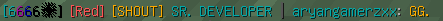
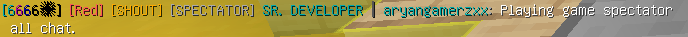

# HeronikaBedwarsChat

A customizable chat formats & management plugin for **BedWars1058**, built for Minecraft **1.8.8**.

HeronikaBedwarsChat provides separate chat formats for the lobby, waiting rooms, active-game team chat, global shout, and spectators.
It also includes configurable shout cooldowns, permission-based cooldown bypass, chat moderation commands, and configuration reloading.

## Compatibility

The compatibility layer currently targets these BedWars1058 versions:

- v22.3.4
- v23.2.1
- v23.3
- v23.12.2
- v24.9
- v25.2

## Features

- Customizable chat formats for each BedWars state.
- Separate team chat during active games.
- Global shout using `!` before a message.
- Configurable shout cooldown with `ms`, `s`, `m`, and `h` units.
- Permission-based shout cooldown bypass.
- Vanilla-white default message text while retaining manually typed `&` color codes.
- Separate spectator chat for players who join an ongoing game only to watch.
- Separate team-only chat for eliminated players spectating their former teammates.
- Global shout for eliminated players using `!`.
- Automatic `GG.` messages from the surviving winners and the final player listed as eliminated when a game ends; messages stay inside that arena.
- Lobby and waiting-room chat formats.
- `/hbc clearchat` to clear chat for everyone online.
- `/hbc reload` to reload the configuration.
- `/hbc stopchat` to toggle chat on or off.
- Admin permission that grants every plugin permission.
- Configurable player-facing command, cooldown, and chat-status messages.

## Requirements

- Minecraft 1.8.8 server.
- Spigot/PaperSpigot 1.8.8-compatible server.
- BedWars1058.
- The HeronikaBedwarsChat plugin is compiled for Java 8 bytecode.
- BedWars1058 22.3.4 and 23.2.1 use Java 8 bytecode in the supplied JARs. The supplied 23.3, 23.12.2, 24.9, and 25.2 JARs use Java 11 bytecode, so those BedWars1058 releases require Java 11 or newer.
- The Minecraft server version must also be supported by the selected BedWars1058 release; matching the BedWars API does not by itself guarantee compatibility with every Minecraft server version.

The project is compiled against the BedWars1058 v23.2.1 API JAR included in `libs/`. A compatibility layer selects the matching adapter at startup. The adapter implementations share the API calls verified to exist in all six target releases.

## Installation

1. Download the plugin JAR from the repository's Releases section.
2. Place `HeronikaBedwarsChat-<version>.jar` in your server's `plugins` folder.
3. Make sure BedWars1058 is installed.
4. Start or restart the server.
5. Edit `plugins/HeronikaBedwarsChat/config.yml` to customize chat formats and messages.
6. Run `/hbc reload` after editing the configuration.

## Chat behavior

| Situation | Behavior |
|---|---|
| Lobby | Uses the lobby chat format |
| Waiting / starting | Uses the waiting chat format |
| Active game, normal message | Sent to the player's team |
| Active game, message starting with `!` | Global shout to arena players and spectators |
| Spectator who joined to watch | Uses `format-chat-spectator`; message goes to that arena's spectators |
| Eliminated player spectating their team | Uses `format-game-spectator`; message goes to their team only |
| Eliminated player message starting with `!` | Uses `format-game-global-spectator`; shout goes to arena players and spectators |
| Game ends | Surviving winners and the final eliminated player send a formatted `GG.` line to players in that arena only |
| Chat disabled | Normal chat is blocked until re-enabled; admins can still chat |

In an active game, prefix a message with `!` to send a global shout. The initial exclamation mark is removed. For example:

```text
!Good luck everyone!
```

Normal in-game messages are white by default. Players can still use supported `&` color codes in their messages.

Eliminated players who are spectating their own team use a separate team-only chat. They can prefix a message with `!` to shout to everyone in that arena. Players who joined the arena as spectators without participating use the separate spectator-only chat format.

When a BedWars1058 game ends, the plugin sends `GG.` from the surviving winners (`getAliveWinners`) and the final UUID in BedWars1058's losers list. Players who have left the arena or are marked as leaving are excluded. The message is delivered only to players and spectators still belonging to that arena; lobby players and players in other arenas do not receive it. Each line uses the speaker's level, team, BedWars1058 chat prefix, and the configured `format-auto-gg` format.

## Chat Format Previews

### Lobby Chat - shows in lobby only.


### Team Chat - shows to teammates only in-game.


### Global Shout - shows to all players in a game, including spectators.


### AutoGG - automatically says GG at the end of the game.


### Non-Playing Spectator - when you spectate a game that you weren't playing.


### Playing-Game Spectator - when you are playing the game and spectating it for your teammates, it is the global chat that shows to everyone.


### Playing-Game Spectator Team Chat - when you chat without using ! shows to teammates only.


## Commands

| Command | Description | Permission |
|---|---|---|
| `/hbc` or `/hbc help` | Displays the available subcommands. | None |
| `/hbc clearchat` | Clears chat for all players online and broadcasts the configured clear message. | `heronikachat.bw.clearchat` |
| `/hbc reload` | Reloads `config.yml`. | `heronikachat.bw.reload` |
| `/hbc stopchat` | Toggles chat between disabled and enabled. | `heronikachat.bw.stopchat` |

The `/hbc stopchat` command is a toggle: the first use disables chat, and the next use enables it again.

## Permissions

| Permission | Description | Default |
|---|---|---|
| `heronikachat.bw.shoutbypass` | Bypasses the global shout cooldown. | OP |
| `heronikachat.bw.clearchat` | Allows `/hbc clearchat`. | OP |
| `heronikachat.bw.reload` | Allows `/hbc reload`. | OP |
| `heronikachat.bw.stopchat` | Allows `/hbc stopchat`. | OP |
| `heronikachat.bw.admin` | Grants all plugin permissions and bypasses the shout cooldown. | OP |

`heronikachat.bw.admin` inherits all four individual permissions.

Example LuckPerms commands:

```text
/lp group moderator permission set heronikachat.bw.clearchat true
/lp group moderator permission set heronikachat.bw.stopchat true
/lp group admin permission set heronikachat.bw.admin true
```

## Configuration

The default `config.yml`:

```yaml
prefix: '&5&lHERONIKA &7» '

shout-cooldown: "5s"
shout-cooldown-message: "{prefix}&cYou must wait {time}s before shouting again."

clearchat-message: "{prefix}&4&lChat has been cleared."
reload-message: "{prefix}&6Configuration reloaded."
chat-disabled-message: "{prefix}&cChat has been disabled."
chat-enabled-message: "{prefix}&2Chat has been enabled."
chat-disabled-notice: "{prefix}&cChat is currently disabled."
no-permission-message: "{prefix}&cYou don't have permission to use this command."
command-usage-message: "{prefix}&cUsage: /hbc"
command-help-message: |-
  {prefix}&eAvailable commands:
  {prefix}&6/hbc help &8» &7Show this help message
  {prefix}&6/hbc clearchat &8» &7Clear chat for everyone
  {prefix}&6/hbc reload &8» &7Reload the configuration
  {prefix}&6/hbc stopchat &8» &7Toggle chat &2on &7or &coff

format-chat-lobby: '{level} {vPrefix}{name}&7: {message}'
format-chat-waiting: '{level} {vPrefix}{name}&7: {message}'
format-chat-global: '{level} {team} &6[SHOUT] {vPrefix}{name}&7: {message}'
format-chat-team: '{level} {team} {vPrefix}{name}&7: {message}'
format-chat-spectator: '{level} &7[SPECTATOR] {vPrefix}{name}&7: {message}'
format-game-spectator: '{level} {team} &7[SPECTATOR] {vPrefix}{name}&7: {message}'
format-game-global-spectator: '{level} {team} &6[SHOUT] &7[SPECTATOR] {vPrefix}{name}&7: {message}'
format-auto-gg: '{level} {team} &6[SHOUT] {vPrefix}{name}&7: &6GG.'
```

### Shout cooldown units

`shout-cooldown` accepts:

- `500ms` — milliseconds
- `5s` — seconds
- `2m` — minutes
- `1h` — hours
- `0` — disables the cooldown

### Available chat placeholders

| Placeholder | Description |
|---|---|
| `{level}` | BedWars1058 player level display |
| `{team}` | Player's colored team name, when applicable |
| `{vPrefix}` | Prefix provided by BedWars1058 chat support |
| `{vSuffix}` | Suffix provided by BedWars1058 chat support |
| `{name}` | Player name |
| `{player}` | Alias for player name |
| `{message}` | Chat message |

The following format keys are also available:

| Configuration key | Used for |
|---|---|
| `format-chat-spectator` | Players who join an ongoing game as spectators |
| `format-game-spectator` | Eliminated players spectating their own team; team-only chat |
| `format-game-global-spectator` | Eliminated players' `!` shouts to the arena |
| `format-auto-gg` | Automatic end-of-game GG lines for winners and losers |

All chat formats support `&` color codes.

### Available message placeholders

| Placeholder | Used in |
|---|---|
| `{player}` | Clear-chat, chat-enabled, and chat-disabled messages |
| `{time}` | Shout cooldown message; remaining time in seconds |

All player-facing responses, including permission-denied, command-usage, and help messages, are configurable in `config.yml`. The `{prefix}` variable is available in messages and chat formats.

## Building from source

This project uses Gradle.

On Windows:

```bat
.\gradlew.bat clean build --no-configuration-cache
```

On Linux:

```bash
./gradlew clean build --no-configuration-cache
```

The output JAR is generated in:

```text
build/libs/
```


The required API methods used by HeronikaBedwarsChat were compared across the supplied JARs. The arena lookup, arena state, spectator/player lists, team membership/display, level display, server type, lobby world, and Vault chat prefix/suffix signatures are shared across these releases. Runtime testing on each server version is still recommended before production deployment.

The source is organized into two main packages:

- `org.heronika.heronikabedwarschat.core` contains the main plugin class and shared chat, command, configuration, and formatting classes.
- `org.heronika.heronikabedwarschat.compatibility` contains the compatibility interface, arena context, shared API implementation, six version adapters, and adapter selector.

## License

Add your chosen open-source license before publishing this repository. If you choose MIT, include the standard MIT `LICENSE` file and update this section accordingly.
